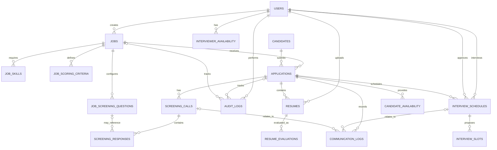

# Entity Relationship Diagram

The diagram below shows the main relationships in the initial PostgreSQL schema. Mermaid diagrams render in GitHub Markdown.

## How to read it

- `||` means exactly one related record.
- `o|` means zero or one related record.
- `o{` means zero or many related records.
- A foreign key connects a child record to its parent record.

## Most important relationship

`candidates` and `jobs` are connected through `applications`:

- One candidate can have many applications.
- One job can receive many applications.
- Each application belongs to one candidate and one job.
- The recruitment status is stored on the application because the same person may have different outcomes for different jobs.

## Agent data ownership

- Agent 1 reads a resume and job rubric; each completed evaluation is stored in `resume_evaluations` against a specific `resumes` row.
- Agent 2 creates a `screening_calls` row for each attempt. Individual question/answer pairs are stored in `screening_responses`; the transcript and summary stay on the call record.
- Agent 3 uses `candidate_availability` and `interviewer_availability`, stores the scheduling process in `interview_schedules`, and stores proposed times in `interview_slots`.
- HR decisions and system/agent actions are recorded in `audit_logs`.
